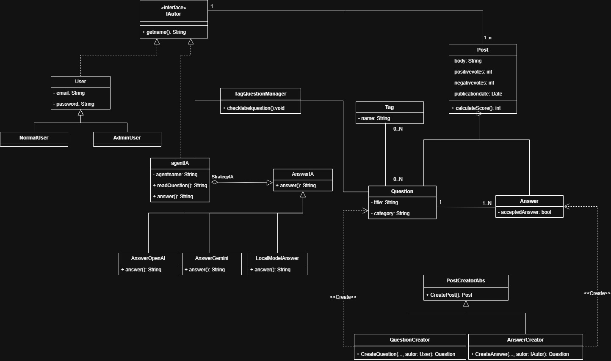

INTEGRANTES  
#Integrante 1  
Alejo Rossaroli Audisio - 47.666.714 - t1Alejo  
#Integrante 2  
Florencia Tosolini Paez - 46.887.645 - QC-fl0r1  
#Integrante 4  
Gonzalo Mateo Garcia - 43.606.495 - MG4rc1a  
# TP-IS1
Justificacion de uso de patrones  
**Abstract Factory**  
Se utiliza el patron para la creacion de publicaciones, con las factorias concretas de "pregunta" y "respuesta" correspondientemente para c/u  
**Strategy**  
Se utiliza el patron para variar el comportamiento de las respuestas con respecto a cada agente de IA que responda a una publicacion  

