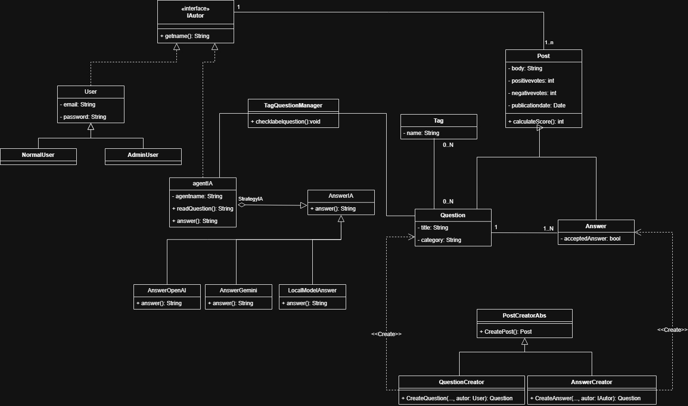
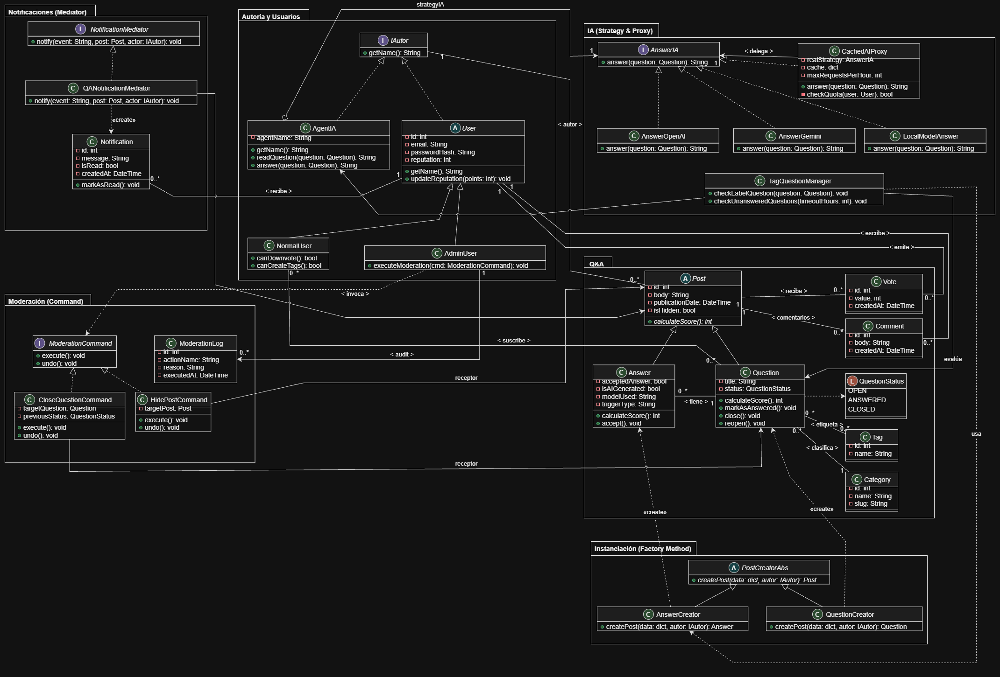

# Plataforma de Preguntas y Respuestas — Taller IS1

---

## Descripción

Plataforma web de preguntas y respuestas (**Q&A**), desarrollada en el contexto del Taller de la asignatura **Ingeniería de Software I** (UNRC)

El sistema permite a los usuarios publicar consultas organizadas por categorías y etiquetas (`#tags`), responder, comentar, votar aportes según su reputación y aceptar soluciones. Como diferencial principal, integra **Agentes de IA (`AgentIA`)** que actúa como un autor más dentro del foro, capaz de asistir de forma automatizada mediante distintos proveedores de modelos de lenguaje (OpenAI, Gemini o modelos locales).

### Patrones de Diseño y Justificacion
* **Factory Method:**  
  Desacopla la instanciación de las publicaciones (`Question` y `Answer`), permitiendo validar reglas específicas al crearlas (por ejemplo, que solo un humano pueda crear preguntas, mientras que tanto humanos como la IA     pueden generar respuestas) sin acoplar el resto del sistema a los constructores concretos.
* **Strategy:**  
  Permite encapsular e intercambiar distintos proveedores o algoritmos de LLM en tiempo de ejecución sin tener que modificar la lógica interna del agente inteligente.
* **Proxy:**  
  Actúa como intermediario frente al modelo de IA real para controlar el acceso antes de consumir recursos externos: verifica si ya existe una respuesta en caché para preguntas similares y controla cuotas de uso por   usuario.
* **Mediator:**  
  Centraliza la coordinación de notificaciones cuando ocurre un evento relevante (como una nueva respuesta o una solución aceptada), evitando que las clases `Question`, `Answer` y `User` estén  acopladas entre sí para enviarse avisos.
* **Command:**  
  Encapsula cada acción administrativa como un objeto independiente, lo que permite registrar un historial de auditoría de cambios y soportar la operación undo() para revertir acciones de moderación.
---

## Diagrama UML

**Version 1**

**Version 2**

---

## Integrantes

| Integrante | Usuario | DNI |
| :--- | :--- | :--- |
| **Integrante 1** - *Alejo Rossaroli Audisio* | [@t1Alejo](https://github.com/t1Alejo) | 47.666.714 |
| **Integrante 2** - *Florencia Tosolini Paez* | [@QC-fl0r1](https://github.com/QC-fl0r1) | 46.887.645 |
| **Integrante 3** - *Jorge Gabriel Zamudio Villarroel* | [@bot-topper](https://github.com/bot-topper) | 47.570.596 |
| **Integrante 4** - *Gonzalo Mateo Garcia* | [@MG4rc1a](https://github.com/MG4rc1a) | 43.606.495 |
| **Integrante 5** - *Santino Gatti Raggi* | [@GoblinCrimes](https://github.com/GoblinCrimes) | 47.988.332 |

---
